# Shelf Serif

https://github.com/user-attachments/assets/26863264-9e40-4ba2-ad4e-041fdd69e0e2

Shelf Serif is a near-monoline, squared serif made for [Grok Bot Shelf](https://grokbotshelf.com). Its bowls are rounded rectangles with flat sides, and its stems stand on thin slab serifs, the "shelves" in the name. Light is drawn to sit beside the GROK BOT SHELF wordmark.

- Five named weights, from 300 to 700, in one variable font.
- Static OTF and hinted TTF files for Light, Regular and Bold.
- 244 glyphs covering Basic Latin, Latin-1 and Windows-1252 punctuation.
- Free for personal and commercial use under the [SIL Open Font License 1.1](OFL.txt).

Current version is 5.000.

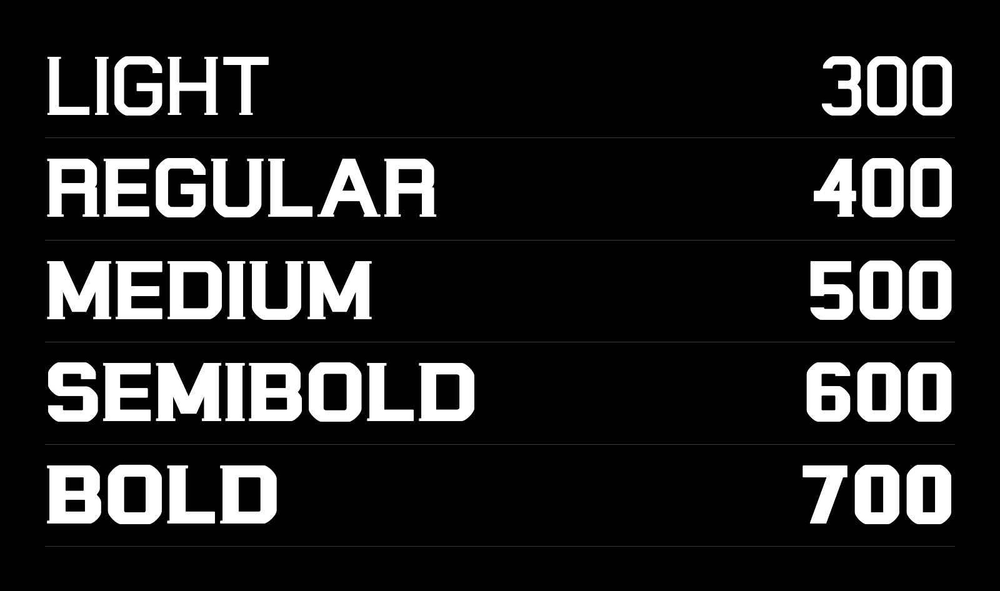

## Contents

- [Install on your computer](#install-on-your-computer)
- [Use it on the web](#use-it-on-the-web)
- [Font faces](#font-faces)
- [OpenType features and ligatures](#opentype-features-and-ligatures)
- [Character set](#character-set)
- [Files](#files)
- [Design details](#design-details)
- [Known limitations](#known-limitations)
- [Build from source](#build-from-source)
- [License](#license)

## Install on your computer

[Download ShelfSerif-5.000.zip](https://github.com/itsthecsguy/shelf-serif/releases/download/v5.000/ShelfSerif-5.000.zip) from the [5.000 release](https://github.com/itsthecsguy/shelf-serif/releases/tag/v5.000), unpack it and open the `fonts` folder. The ZIP holds the fonts, the stylesheet and the license.

**Which file should you install?** Use `fonts/variable/ShelfSerif[wght].ttf` if your app supports variable fonts, because it holds all five weights. Otherwise install the three static files for your platform. Medium and SemiBold exist only in the variable font.

Don't install the static and variable files together, since they share a family name and apps can pick the wrong one.

### macOS

Double-click a font file and press **Install** in Font Book, or copy the files from a terminal.

```bash
cp fonts/otf/*.otf ~/Library/Fonts/
```

### Windows

Select the `.ttf` files in `fonts/ttf`, right-click and choose **Install**. These are the hinted files, so they are the right choice on Windows.

### Linux

```bash
mkdir -p ~/.local/share/fonts
cp fonts/otf/*.otf ~/.local/share/fonts/
fc-cache -f
```

### Design apps

Figma's desktop app, Adobe apps and Sketch use the fonts installed on your system. Install the font as above and restart the app, then pick **Shelf Serif** from the font list.

## Use it on the web

### From a CDN

The quickest way to try it is one line of HTML, served by jsDelivr from this repository.

```html
<link rel="stylesheet" href="https://cdn.jsdelivr.net/gh/itsthecsguy/shelf-serif@v5.000/css/shelf-serif.css">

<style>
  body { font-family: var(--font-shelf-serif); font-weight: 400; }
  h1 { font-weight: 700; }
</style>
```

### Self-hosted

Copy `fonts/woff2/` and `css/shelf-serif.css` into your site and keep them in the same relative layout, with `css/` next to `fonts/`. The CSS also points at `fonts/variable/` and `fonts/ttf/` as fallbacks, so copy those too if you want them.

```html
<link rel="stylesheet" href="css/shelf-serif.css">
```

To skip the stylesheet, declare the variable font yourself. It's 26 KB as WOFF2.

```css
@font-face {
  font-family: "Shelf Serif";
  src: url("/fonts/ShelfSerif[wght].woff2") format("woff2");
  font-weight: 300 700;
  font-style: normal;
  font-display: swap;
}

body {
  font-family: "Shelf Serif", Georgia, serif;
}
```

### What the stylesheet gives you

| Name | What it does |
| --- | --- |
| `"Shelf Serif"` | The variable font, any `font-weight` from 300 to 700 |
| `"Shelf Serif Static"` | Static Light (300), Regular (400) and Bold (700), for browsers without variable font support |
| `--font-shelf-serif` | The full stack, `"Shelf Serif", "Shelf Serif Static", Georgia, serif` |
| `.shelf-caps` | The wide-tracked capitals of the wordmark, in Light. Add `.regular` or `.bold` for the other weights |
| `.shelf-pnum` | Proportional figures, for numbers in running text |
| `.shelf-tnum` | Tabular figures, for columns of numbers |

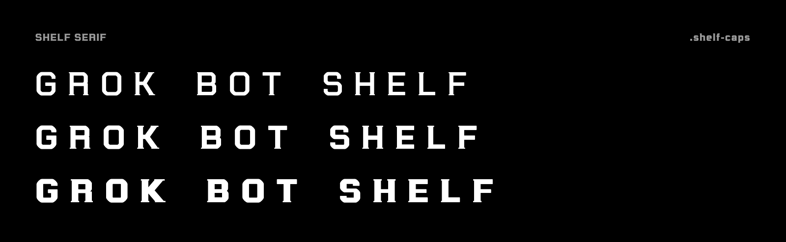

```html
<h1 class="shelf-caps">Grok Bot Shelf</h1>
<h2 class="shelf-caps bold">Grok Bot Shelf</h2>
<p class="shelf-pnum">Shipped 1,024 bots in 2026.</p>
```

### Next.js

Copy `fonts/woff2/ShelfSerif[wght].woff2` into your app and rename it `ShelfSerif-Variable.woff2`, then load it with `next/font/local`.

```tsx
// app/layout.tsx
import localFont from 'next/font/local'

const shelfSerif = localFont({
  src: './ShelfSerif-Variable.woff2',
  weight: '300 700',
  display: 'swap',
  variable: '--font-shelf-serif',
})

export default function RootLayout({ children }: { children: React.ReactNode }) {
  return (
    <html lang="en" className={shelfSerif.variable}>
      <body>{children}</body>
    </html>
  )
}
```

### Tailwind CSS

With Tailwind v4, add the family to your theme and use the `font-shelf` class.

```css
@import "tailwindcss";

@theme {
  --font-shelf: "Shelf Serif", Georgia, serif;
}
```

```html
<h1 class="font-shelf font-bold">Shelf Serif</h1>
```

## Font faces

| Face | CSS weight | Stem (per 1000) | Horizontal (per 1000) | Static file | Variable font |
| --- | --- | --- | --- | --- | --- |
| Light | 300 | 110 | 94 | Yes | Yes |
| Regular | 400 | 142 | 121 | Yes | Yes |
| Medium | 500 | interpolated | interpolated | No | Yes |
| SemiBold | 600 | interpolated | interpolated | No | Yes |
| Bold | 700 | 190 | 140, with a 104 middle stroke in stacked letters | Yes | Yes |

The variable font accepts any weight between 300 and 700, not just these five.

### Light, 300

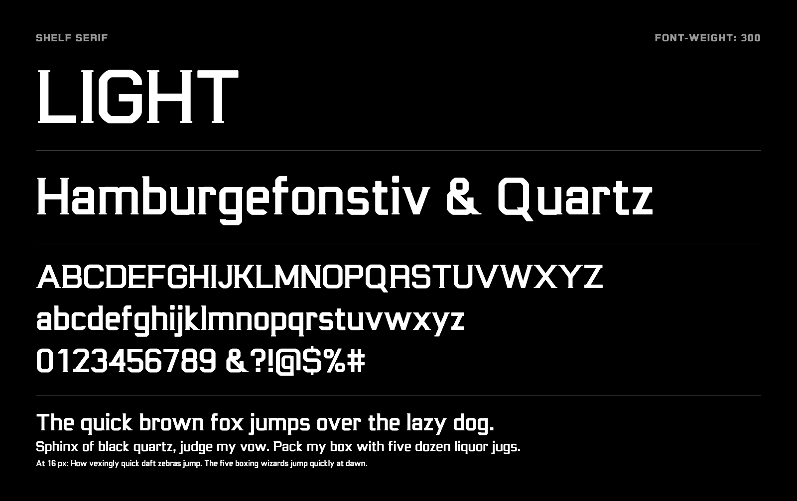

### Regular, 400

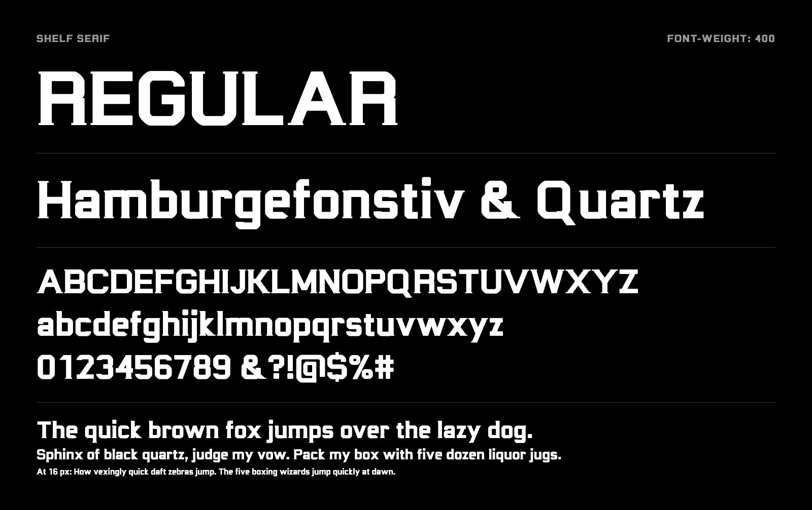

### Medium, 500

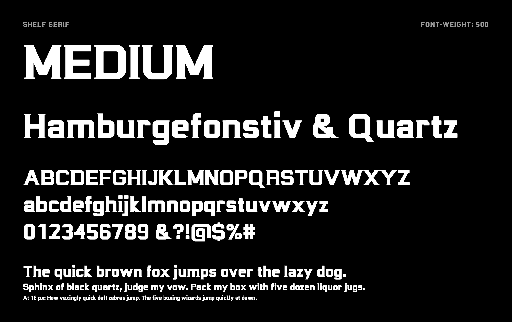

### SemiBold, 600

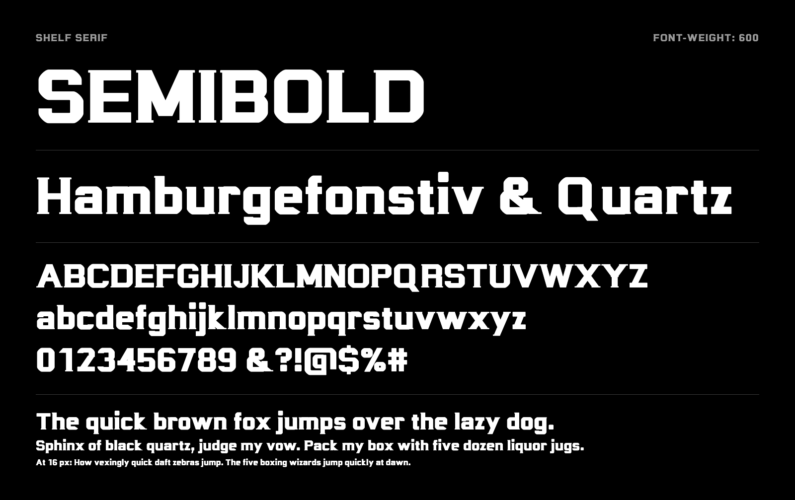

### Bold, 700

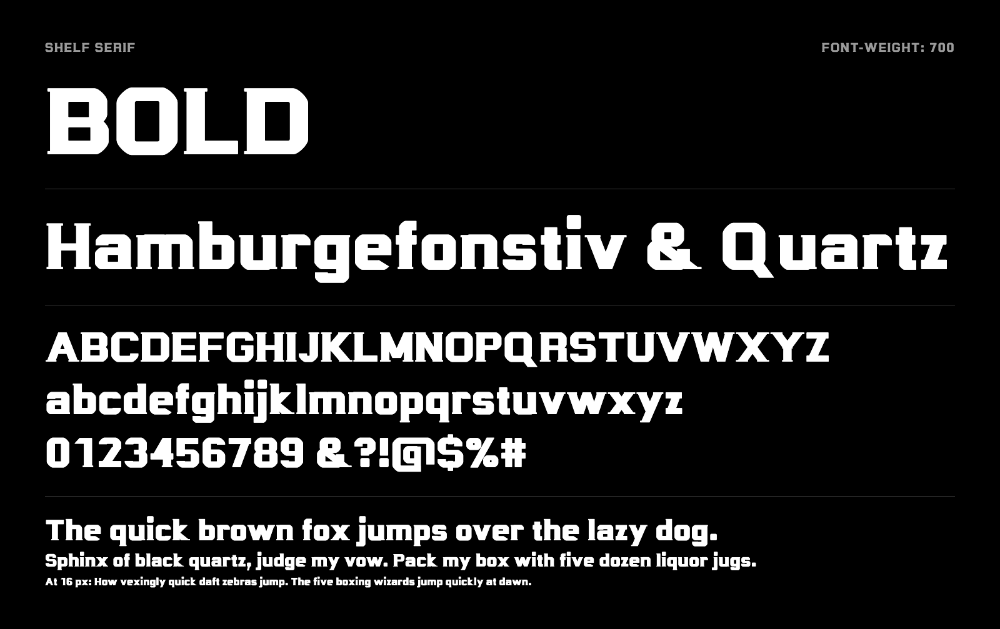

### Sizes

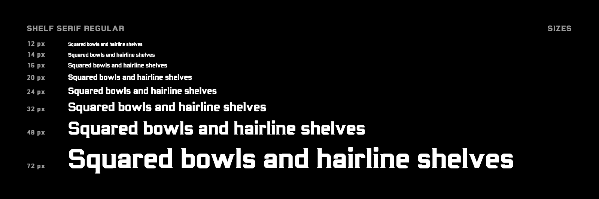

## OpenType features and ligatures

**Shelf Serif has no ligatures.** It has no `liga` or `dlig` feature and no ligature glyphs, so `fi`, `fl`, `ff`, `ffi` and `ffl` are always set as separate letters. The f's hook stops short of the next letter, so these pairs don't need a ligature to stay clear of each other.

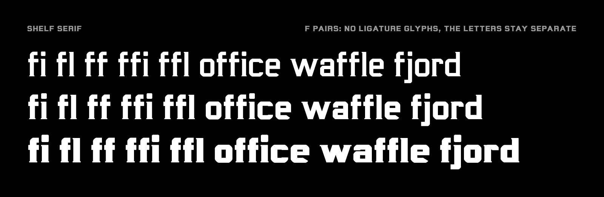

These are the features the font does have.

| Feature | What it does | CSS |
| --- | --- | --- |
| `kern` | Class-based kerning. Accented letters use their base letter's pairs | On by default, `font-kerning: normal` |
| `tnum` | Tabular figures, which are the default figures | `font-variant-numeric: tabular-nums` |
| `pnum` | Proportional figures | `font-variant-numeric: proportional-nums` |
| `mark` | Positions combining accents on their base letters | Always on |
| `ccmp` | Swaps i and j for dotless forms under an accent above | Always on |

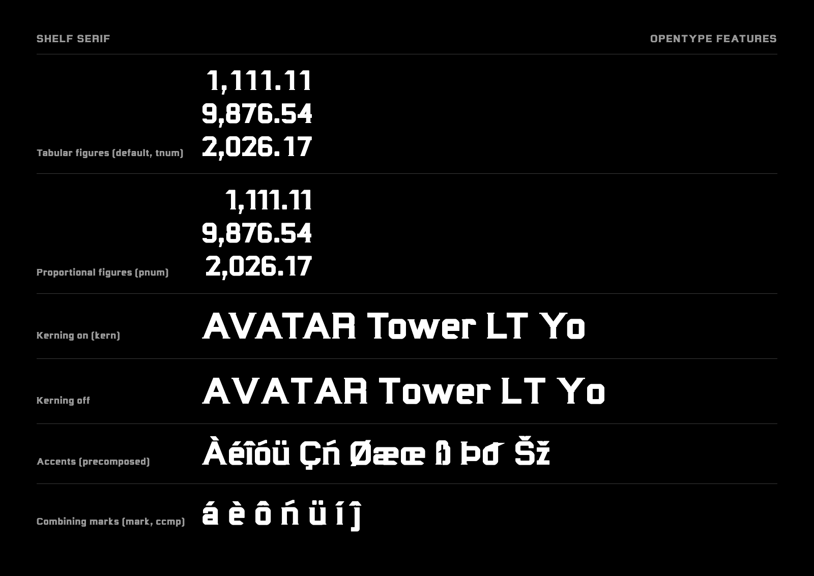

## Character set

The font has 244 glyphs and 233 Unicode codepoints.

- All of Basic Latin, and Latin-1 Supplement except the soft hyphen.
- Œ œ Š š Ž ž Ÿ ı ȷ.
- Windows-1252 punctuation, including dashes, curly quotes, guillemets, bullet, ellipsis, daggers and the per mille sign.
- € ¢ £ ¥ ¤ ™ − ×, and spacing and combining accents.

There is no Greek, Cyrillic or Latin Extended beyond the letters listed above.

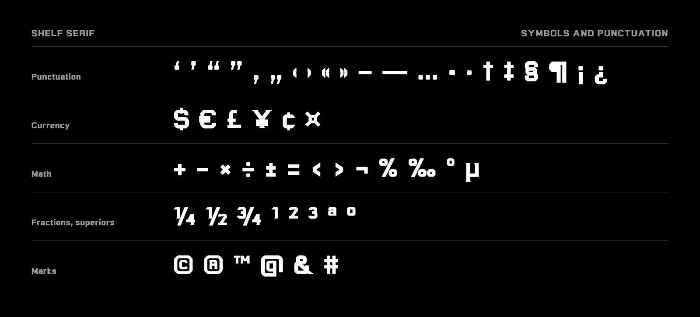

The charts below show each face's 221 visible characters. They leave out the space, the no-break space and the combining marks.

<details>
<summary>Light</summary>

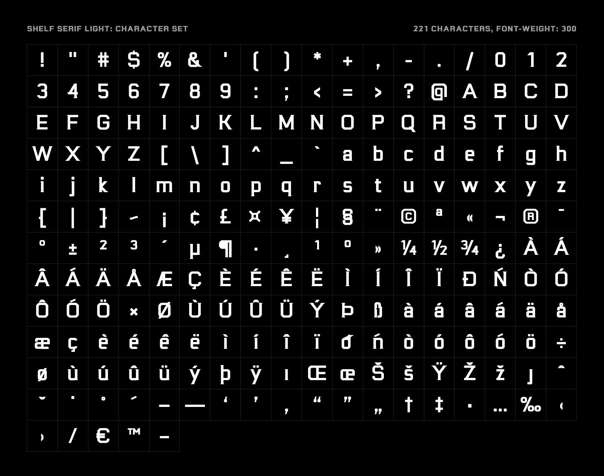

</details>

<details>
<summary>Regular</summary>

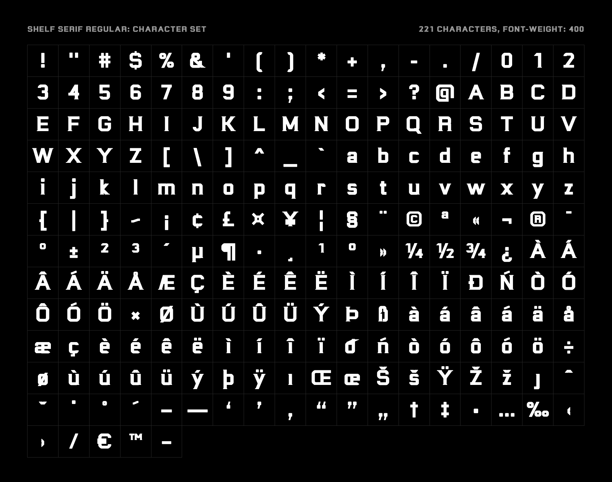

</details>

<details>
<summary>Medium</summary>


</details>

<details>
<summary>SemiBold</summary>

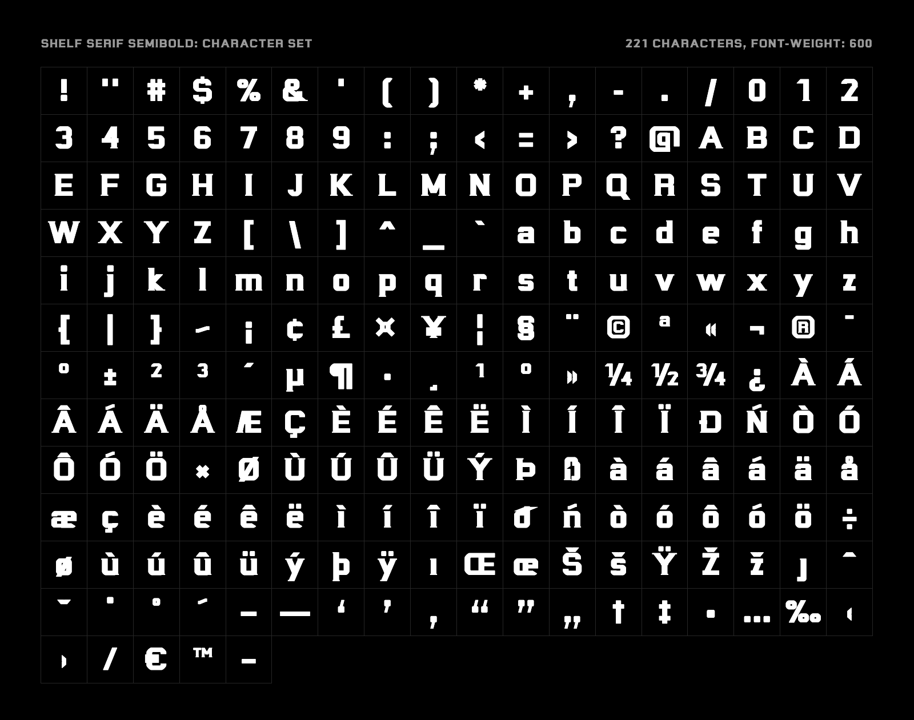

</details>

<details>
<summary>Bold</summary>


</details>

## Files

| Path | Contents | Size each |
| --- | --- | --- |
| `fonts/variable/ShelfSerif[wght].ttf` | Variable TrueType, `wght` 300 to 700, unhinted | 70 KB |
| `fonts/otf/ShelfSerif-{Light,Regular,Bold}.otf` | Static CFF | 20 KB |
| `fonts/ttf/ShelfSerif-{Light,Regular,Bold}.ttf` | Static TrueType, hinted with ttfautohint | 50 KB |
| `fonts/woff2/ShelfSerif[wght].woff2` | Variable font for the web | 26 KB |
| `fonts/woff2/ShelfSerif-{Light,Regular,Bold}.woff2` | Static fonts for the web | 18 KB |
| `css/shelf-serif.css` | `@font-face` rules and the helper classes | |
| `generator/` | The Python that draws and checks every glyph | |
| `docs/make_images.py` | Renders the images in this README and the repository's social preview | |
| `docs/make_video.py`, `docs/video/` | Renders the launch video at the top of this README | |

## Design details

All measurements are per 1000 units of the em. The fonts are written at 2048 units per em.

| Metric | Value |
| --- | --- |
| Cap height | 700 |
| x-height | 520 |
| Ascender | 730 |
| Descender | -200 |
| Default line height | 1.2 em, the same on every platform |

- **Shelves.** Serifs are 20 units thick in Light, 24 in Regular and 30 in Bold.
- **Bowls.** Every bowl is a rounded rectangle. A tight outer corner meets a much smaller inner corner, so counters stay square.
- **Terminals.** Strokes end in level or plumb cuts. The parentheses are the one exception.
- **Bold.** Three-storey letters such as B, E, S and 8 use a thinner middle stroke, which keeps their counters open at a 190-unit stem.

Nothing in the font was traced or imported. Every outline is built by the code in `generator/` from four shapes, which are a rounded rectangle, a ring, a slice of a ring and a straight diagonal. The GROK BOT SHELF wordmark contributed measurements, not outlines.

## Known limitations

- There is no italic.
- At 12 to 14 px on a 1x display, the shelves are under 0.4 px thick and fade out, so text reads as a squared sans. They are clear at 2x.
- The tilde is a step shape, which can read like an acute accent at small sizes.
- The eth (ð) and eszett (ß) are readable but unconventional.
- Superiors, fractions, ª, º, ™ and the letters inside © and ® are scaled versions of the full-size shapes, not separate drawings.
- The TTF hinting passed Font Bakery but has not been viewed on Windows.

## Build from source

The fonts are generated, so a design change means editing the code and rebuilding. `build.sh` uses zsh, which macOS includes. The fonts here were built with Python 3.14.

```bash
git clone https://github.com/itsthecsguy/shelf-serif.git
cd shelf-serif
python3 -m venv .venv
.venv/bin/pip install -r requirements.txt
./build.sh
```

`build.sh` replaces everything in `fonts/`. It writes UFO masters to `sources/` (not committed), compiles them with fontmake, then hints the static TTFs, finishes the variable font and writes WOFF2.

| File | Purpose |
| --- | --- |
| `generator/params.py` | Stem, stroke, serif and corner values for each weight |
| `generator/geom.py` | The four drawing shapes |
| `generator/glyphs.py`, `glyphs_ext.py` | One function per glyph |
| `generator/spacing.py` | Kerning classes and pairs |
| `generator/check_outlines.py` | Checks the built fonts for path direction, extremes and kinks |
| `generator/check_spacing.py` | Audits sidebearings and the clearance between letter pairs |
| `generator/preview.py` | Renders any list of glyph names in every weight |

Code comments mention earlier working versions of the design, which aren't part of this repository.

To run the checks:

```bash
.venv/bin/python generator/check_outlines.py
.venv/bin/python generator/check_spacing.py
```

To run Font Bakery and regenerate the README images, install the extra tools first.

```bash
.venv/bin/pip install fontbakery playwright
.venv/bin/playwright install chromium
.venv/bin/fontbakery check-universal fonts/otf/*.otf
.venv/bin/python docs/make_images.py
```

`docs/make_video.py` re-renders the launch video from the current fonts, using the same Playwright setup. It also needs ffmpeg with libx264. The video is silent. To add sound, pass a 22-second track of your own with `--audio track.m4a`.

```bash
.venv/bin/python docs/make_video.py
```

The player at the top of this README plays a copy uploaded to GitHub, and the render itself isn't kept in the repository. After a new render, drag the MP4 into a GitHub comment box and put the URL it gives you at the top of this file.

Font Bakery's universal profile reports 0 failures for the OTF, TTF and variable files. Its only warning is for overlapping paths in the variable font, which are deliberate because interpolation needs them.

## License

Copyright 2026 thecsguy. Licensed under the [SIL Open Font License 1.1](OFL.txt).

You can use, embed, modify and redistribute the fonts, including in commercial work. You can bundle them with software or sell them as part of a larger product, but you can't sell the fonts on their own. Modified versions must stay under the same license.
